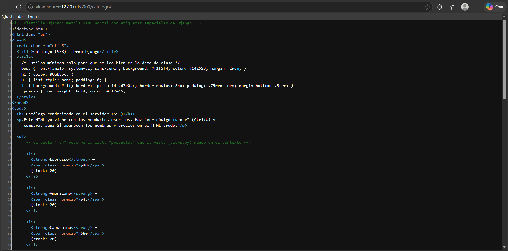
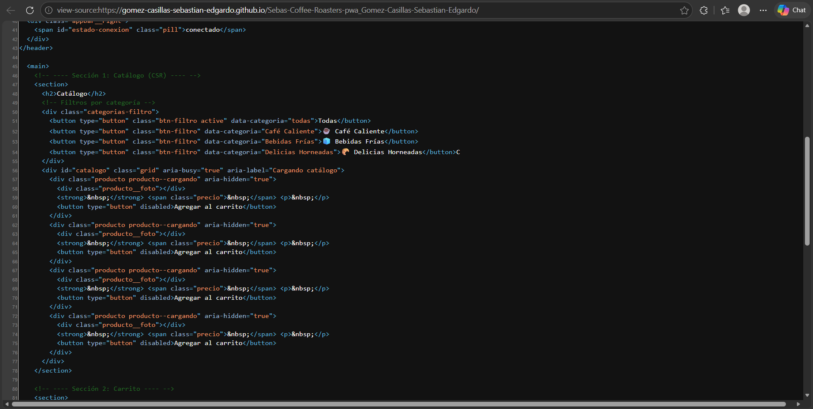
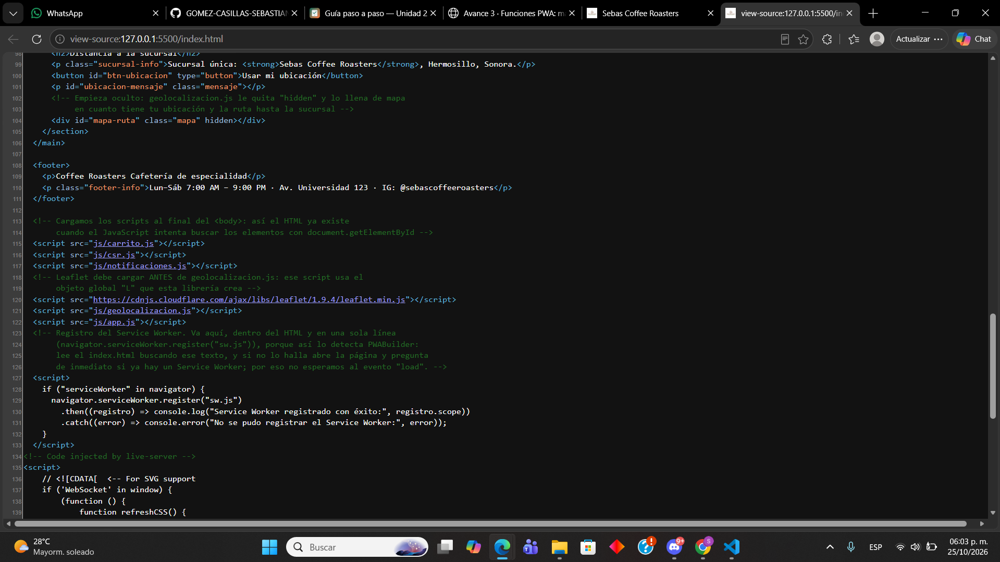
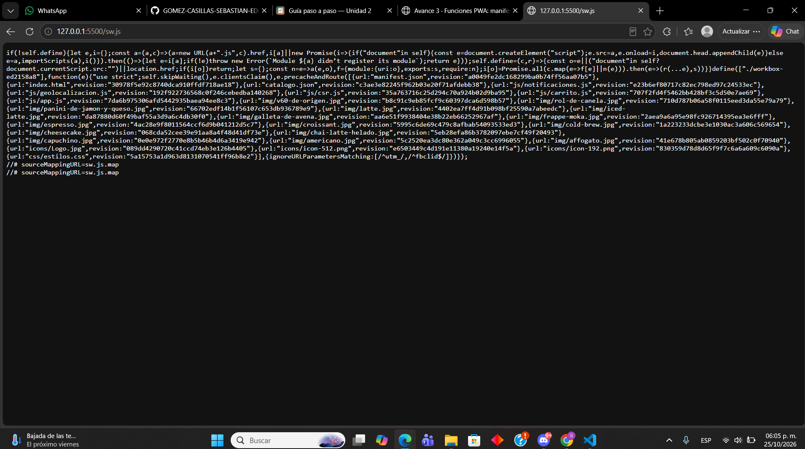

# Nombre de tu negocio — PWA de ventas

| Dato | Valor |
|---|---|
| **Alumno** | GOMEZ CASILLAS SEBASTIAN EDGARDO |
| **Grupo** | ING10-1 |
| **Negocio · giro** | Sebas Coffee Roasters · Cafetería de especialidad |
| **URL del repositorio** | https://github.com/GOMEZ-CASILLAS-SEBASTIAN-EDGARDO/Sebas-Coffee-Roasters-pwa_Gomez-Casillas-Sebastian-Edgardo |
| **URL de GitHub Pages** | https://gomez-casillas-sebastian-edgardo.github.io/Sebas-Coffee-Roasters-pwa_Gomez-Casillas-Sebastian-Edgardo/ |

## Historial de avances

| Avance | Hash del commit entregado | Fecha |
|---|---|---|
| 1 | 36a3e05 | 11/10/2026 |
| 2 | 48dc354 | 18/10/2026 |
| 3 | 9a3ca4a | 25/10/2026 |
| 4 | (se escribe en el reporte PDF) | 01/11/2026 |

## Comparación SSR vs CSR

### SSR (Django): los productos llegan escritos en el HTML

### CSR (JavaScript): el div del catálogo llega vacío

## Funciones PWA (avance 3)

### index.html: manifest y registro del Service Worker activos

### sw.js: Workbox precachea el catálogo y las fotos
