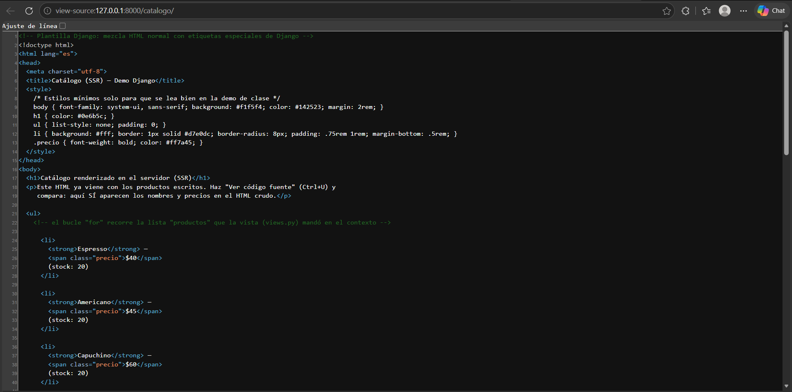
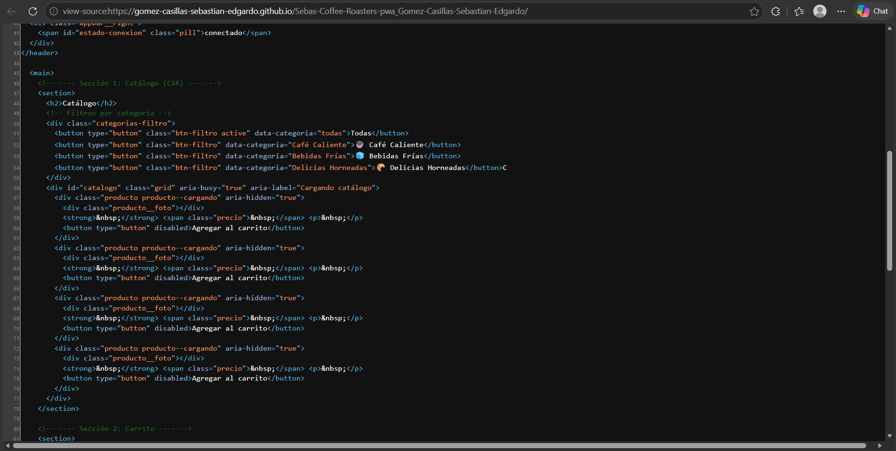
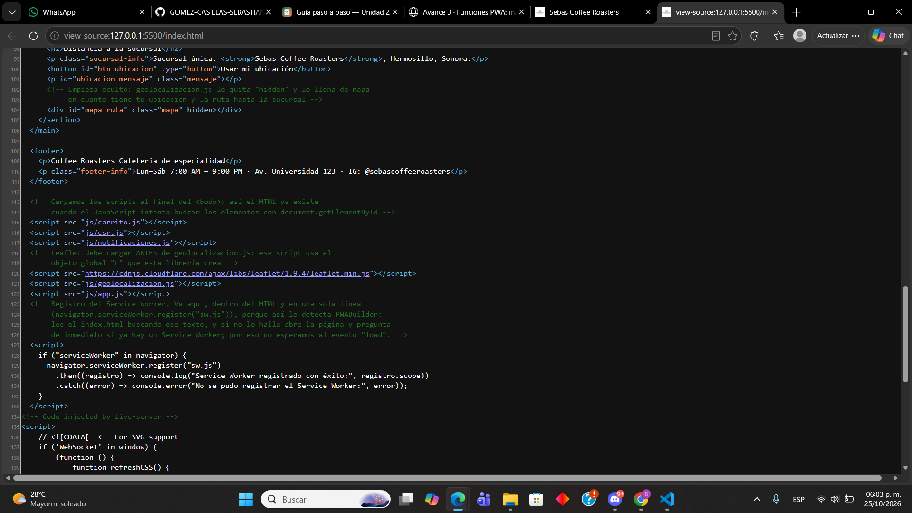
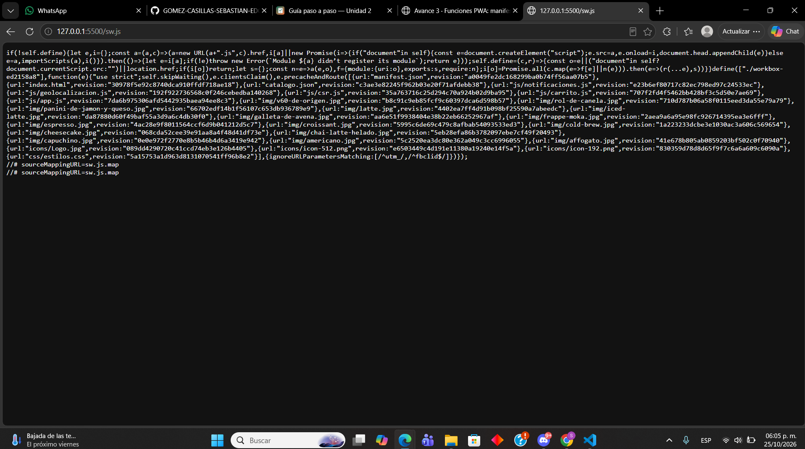

# Sebas-Coffee — PWA de ventas

| Dato | Valor |
|---|---|
| **Alumno** | GOMEZ CASILLAS SEBASTIAN EDGARDO |
| **Grupo** | ING10-1 |
| **Negocio · giro** | Sebas Coffee Roasters · Cafetería de especialidad |
| **URL del repositorio** | https://github.com/GOMEZ-CASILLAS-SEBASTIAN-EDGARDO/Sebas-Coffee-Roasters-pwa_Gomez-Casillas-Sebastian-Edgardo |
| **URL de GitHub Pages** | https://gomez-casillas-sebastian-edgardo.github.io/Sebas-Coffee-Roasters-pwa_Gomez-Casillas-Sebastian-Edgardo/ |

## Historial de avances

| Avance | Hash del commit entregado | Fecha |
|---|---|---|
| 1 | 36a3e05 | 11/10/2026 |
| 2 | 48dc354 | 18/10/2026 |
| 3 | ea80138 | 25/10/2026 |
| 4 | () | 01/11/2026 |

## Comparación SSR vs CSR

### SSR (Django): los productos llegan escritos en el HTML

### CSR (JavaScript): el div del catálogo llega vacío

## Funciones PWA (avance 3)

### index.html: manifest y registro del Service Worker activos

### sw.js: Workbox precachea el catálogo y las fotos

Guia de instalacion de la app para celulares:
La app se puede instalar directo desde el navegador desde esta URL:https://gomez-casillas-sebastian-edgardo.github.io/Sebas-Coffee-Roasters-pwa_Gomez-Casillas-Sebastian-Edgardo/

Android (Chrome)
Abrir Chrome en celular y entrar a la URL de GitHub Pages.
Esperar a que cargue el catálogo con sus fotos. Con eso el Service Worker queda registrado y la app ya se puede instalar.
Tocar el menú de tres puntos (⋮) que está arriba a la derecha.
Seleccionar "Instalar app" (en algunas versiones aparece como "Agregar a la pantalla principal").
En el mensaje de confirmación presionar "Instalar".
El ícono de Sebas Coffee aparecera en la pantalla de inicio y en el cajón de aplicaciones.
Lo seleccionamos para abrirla. Se ve a pantalla completa, sin la barra de direcciones del navegador, como una app normal.

Phone (Safari)
En iPhone la instalación solo funciona desde Safari. Si se abre la URL en Chrome u otro navegador, no aparece la opción.

Abrir Safari en iPhone y entro a la URL de GitHub Pages.
Esperar a que cargue el catálogo completo.
seleccionar el botón Compartir (el cuadrito con una flecha hacia arriba) en la barra inferior.
Deslizar el menú hacia abajo y seleccionar "Agregar a pantalla de inicio".
Dejar el nombre "Sebas Coffe" (o puedes cambiarlo) y seleccionar "Agregar" arriba a la derecha.
El ícono de Sebas Coffe aparece en la pantalla de inicio.
Lo seleccionamos para abrirla. Se abre a pantalla completa, sin las barras de Safari.